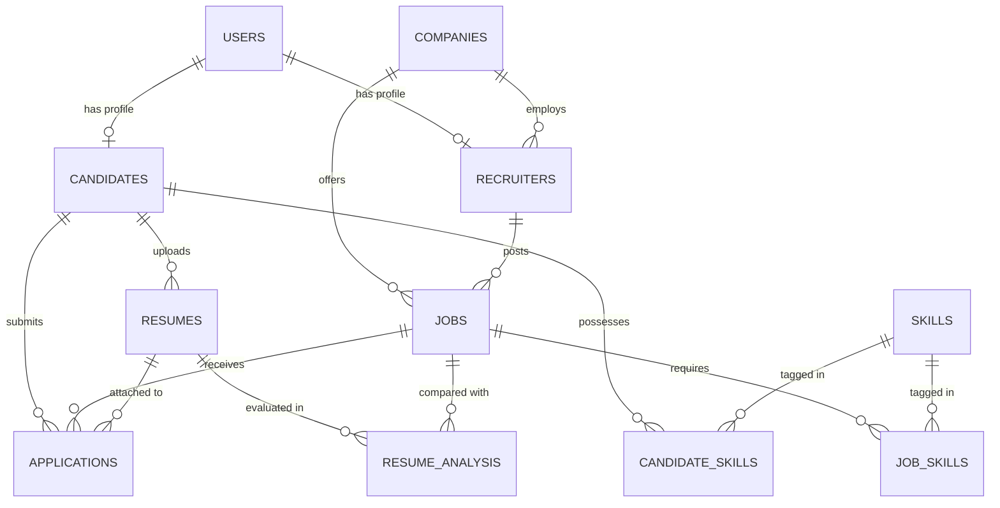

# SkillSphere — Revised Implementation Plan & Technical Architecture

## 1. System Architecture Overview

SkillSphere follows a robust, decoupled three-tier architecture:

```
┌─────────────────────────────────────────────────────────────┐
│             Streamlined React + Vite Frontend               │
│  - Tabbed Dashboards (Low route complexity, high cohesion) │
│  - Tailwind CSS + Lucide Icons                             │
│  - AuthContext + Axios with JWT Interceptors                │
└──────────────────────────────┬──────────────────────────────┘
                               │ HTTP / REST / JSON
                               ▼
┌─────────────────────────────────────────────────────────────┐
│                    FastAPI Backend                          │
│  - Pydantic v2 Schemas (Strict Request/Response Validation)│
│  - Modular API Routers (Auth, Resumes, Jobs, Applications) │
│  - Service Layer (Incremental OCR, Parser, Matcher, Seeder)│
│  - PyMuPDF + Tesseract/Pillow OCR Engine                   │
│  - SQLAlchemy 2.0 ORM with PostgreSQL Constraints          │
└──────────────────────────────┬──────────────────────────────┘
                               │ SQL
                               ▼
┌─────────────────────────────────────────────────────────────┐
│                 PostgreSQL 18 Database                      │
│  - Normalized Relational Tables                            │
│  - Foreign Keys, Cascade Rules                             │
│  - Unique Constraints (uq_active_job_candidate)             │
└─────────────────────────────────────────────────────────────┘
```

---

## 2. Refined Database Schema & Duplicate Prevention

### 2.1 Entity Relationship Diagram



### 2.2 Table Definitions & Key Constraints

1. **`users`**:
   - `id` (UUID, PK)
   - `name` (String, not null)
   - `email` (String, unique index, not null)
   - `password_hash` (String, not null)
   - `role` (Enum: `JOB_SEEKER`, `RECRUITER`, `ADMIN`)
   - `is_active` (Boolean, default True)
   - `created_at`, `updated_at` (DateTime)

2. **`candidates`**:
   - `id` (UUID, PK)
   - `user_id` (UUID, FK -> `users.id`, unique index)
   - `phone` (String, nullable)
   - `title` (String, nullable)
   - `location` (String, nullable)
   - `bio` (Text, nullable)
   - `education` (JSON, default [])
   - `experience` (JSON, default [])
   - `total_years_exp` (Float, default 0.0)

3. **`companies`**:
   - `id` (UUID, PK)
   - `company_name` (String, not null)
   - `description` (Text, nullable)
   - `website` (String, nullable)
   - `location` (String, nullable)
   - `contact_email` (String, nullable)
   - `logo_url` (String, nullable)

4. **`recruiters`**:
   - `id` (UUID, PK)
   - `user_id` (UUID, FK -> `users.id`, unique index)
   - `company_id` (UUID, FK -> `companies.id`, nullable)
   - `designation` (String, nullable)

5. **`resumes`**:
   - `id` (UUID, PK)
   - `candidate_id` (UUID, FK -> `candidates.id`, not null)
   - `file_name` (String, not null)
   - `file_path` (String, not null)
   - `file_type` (String, not null)
   - `file_size` (Integer, not null)
   - `extracted_text` (Text, nullable)
   - `parsed_data` (JSON, default {})
   - `processing_status` (Enum: `PENDING`, `PROCESSING`, `COMPLETED`, `FAILED`)
   - `error_message` (String, nullable)
   - `upload_date` (DateTime)

6. **`skills`**:
   - `id` (UUID, PK)
   - `skill_name` (String, unique index, lowercase)
   - `category` (String, nullable)

7. **`candidate_skills`**:
   - `candidate_id` (UUID, PK, FK -> `candidates.id`)
   - `skill_id` (UUID, PK, FK -> `skills.id`)

8. **`jobs`**:
   - `id` (UUID, PK)
   - `recruiter_id` (UUID, FK -> `recruiters.id`, not null)
   - `company_id` (UUID, FK -> `companies.id`, nullable)
   - `title` (String, not null)
   - `description` (Text, not null)
   - `location` (String, not null)
   - `experience_min` (Float, default 0.0)
   - `experience_max` (Float, default 0.0)
   - `job_type` (Enum: `FULL_TIME`, `PART_TIME`, `CONTRACT`, `INTERNSHIP`, `REMOTE`)
   - `salary_min` (Float, nullable)
   - `salary_max` (Float, nullable)
   - `status` (Enum: `DRAFT`, `ACTIVE`, `CLOSED`, default `ACTIVE`)
   - `created_at`, `updated_at` (DateTime)

9. **`job_skills`**:
   - `job_id` (UUID, PK, FK -> `jobs.id`)
   - `skill_id` (UUID, PK, FK -> `skills.id`)
   - `is_required` (Boolean, default True)

10. **`applications`**:
    - `id` (UUID, PK)
    - `job_id` (UUID, FK -> `jobs.id`, not null)
    - `candidate_id` (UUID, FK -> `candidates.id`, not null)
    - `resume_id` (UUID, FK -> `resumes.id`, not null)
    - `status` (Enum: `APPLIED`, `UNDER_REVIEW`, `SHORTLISTED`, `INTERVIEW`, `SELECTED`, `REJECTED`, `WITHDRAWN`, default `APPLIED`)
    - `cover_letter` (Text, nullable)
    - `application_date` (DateTime)
    - `updated_at` (DateTime)
    - **PostgreSQL Constraint**: `UniqueConstraint('job_id', 'candidate_id', name='uq_job_candidate')`

11. **`resume_analysis`**:
    - `id` (UUID, PK)
    - `resume_id` (UUID, FK -> `resumes.id`)
    - `job_id` (UUID, FK -> `jobs.id`)
    - `match_score` (Float, nullable)
    - `matched_skills` (JSON, default [])
    - `missing_skills` (JSON, default [])
    - `recommendations` (Text, nullable)
    - `analysis_date` (DateTime)

### 2.3 Strict Duplicate Prevention Logic
Duplicate prevention is enforced at both the database layer and application transaction layer:
1. **Database Layer**: Table-level `UniqueConstraint('job_id', 'candidate_id', name='uq_job_candidate')`.
2. **Service Layer**:
   ```python
   # Explicit validation check before insert
   existing = db.query(Application).filter(
       Application.job_id == job_id,
       Application.candidate_id == candidate_id,
       Application.status != ApplicationStatus.WITHDRAWN
   ).first()
   if existing:
       raise HTTPException(status_code=400, detail="You have already applied to this job.")

   try:
       db.add(new_application)
       db.commit()
   except IntegrityError:
       db.rollback()
       raise HTTPException(status_code=400, detail="You have already applied to this job.")
   ```

---

## 3. Incremental OCR & Parsing Pipeline

The resume processing pipeline is structured into five distinct, incremental phases:

```
[Uploaded Resume File (<= 10MB)]
             │
             ▼
   Step 1: Digital PDF Extraction (PyMuPDF - fitz)
   - Extract raw text blocks and coordinates
   - Lightning fast (< 100ms), 100% accurate for digital PDFs
             │ (If text length < 50 chars or file is JPG/PNG)
             ▼
   Step 2: Scanned PDF & Image OCR (Pillow + Preprocessing + OCR)
   - Convert PDF pages to high-resolution images or read image file
   - Image enhancement: Grayscale, contrast normalization, noise reduction
   - Run OCR engine to obtain text stream
             │
             ▼
   Step 3: Contact Info Extraction (Strict Regex)
   - Email: [a-zA-Z0-9_.+-]+@[a-zA-Z0-9-]+\.[a-zA-Z0-9-.]+
   - Phone: Matches international and domestic phone formats
             │
             ▼
   Step 4: Skills Extraction (Dictionary Matching)
   - Normalized matching against 200+ industry skills catalog
   - Word boundary and n-gram analysis
             │
             ▼
   Step 5: Editable Candidate Review Form
   - Return structured preview JSON to frontend
   - Candidate reviews, corrects inaccuracies, and clicks "Save to Profile"
   - Persists verified profile data directly to PostgreSQL
```

---

## 4. Matching Algorithm & Edge Case Resolution

### 4.1 Edge Case Handling (No Required Skills)
If a job description specifies zero required skills ($|S_{job}| = 0$), calculating a percentage is undefined or misleading. The engine handles this edge case explicitly:
```python
if len(required_job_skills) == 0:
    return {
        "match_score": None,
        "matched_skills": [],
        "missing_skills": [],
        "message": "This job does not specify any required skills. Match score cannot be calculated."
    }
```

### 4.2 Standard Matching Formula
When $|S_{job}| > 0$:
- $S_{matched} = S_{candidate} \cap S_{job}$
- $S_{missing} = S_{job} \setminus S_{candidate}$
- $\text{Score} = \text{round}\left(\frac{|S_{matched}|}{|S_{job}|} \times 100, 1\right)$
- Dynamic gap recommendation:
  - $\ge 80\%$: "High match. You possess the key skills for this position."
  - $50\% - 79\%$: "Moderate match. Consider highlighting experience in: [missing skills]."
  - $< 50\%$: "Low match. This role requires foundational skills in: [missing skills]."

---

## 5. Security, Authorization & Ownership Rules

### 5.1 JWT Expiration & Stateless Logout
- **Access Tokens**: Standard JWT containing `{sub: user_id, email: user_email, role: user_role, exp: timestamp}` with 24-hour expiration.
- **Server-side Validation**: FastAPI `get_current_user` dependency catches `ExpiredSignatureError` and `JWTError`, raising HTTP 401 with standard JSON error message.
- **Stateless Logout**: Frontend clears `localStorage.removeItem("token")` and resets global auth state.
- **Axios Interceptor**: Catches any 401 response and automatically redirects to login.

### 5.2 Recruiter Isolation
- In `GET /api/v1/recruiter/applicants`:
  ```python
  applicants = db.query(Application).join(Job).filter(Job.recruiter_id == current_recruiter.id).all()
  ```
  Recruiters can never see applicants from other recruiters.
- In `PUT /api/v1/applications/{id}/status`:
  ```python
  if application.job.recruiter_id != current_recruiter.id:
      raise HTTPException(status_code=403, detail="Forbidden: You cannot modify applicants for jobs you do not own.")
  ```

### 5.3 Candidate Isolation
- In `GET /api/v1/applications`:
  ```python
  my_apps = db.query(Application).filter(Application.candidate_id == current_candidate.id).all()
  ```
- In `PUT /api/v1/applications/{id}/withdraw`:
  ```python
  if application.candidate_id != current_candidate.id:
      raise HTTPException(status_code=403, detail="Forbidden: You cannot withdraw another candidate's application.")
  ```
- In `GET /api/v1/resume/my-resumes`:
  ```python
  my_resumes = db.query(Resume).filter(Resume.candidate_id == current_candidate.id).all()
  ```

### 5.4 Secure Admin Seeding
- The application automatically seeds an admin user upon startup (or via `python -m app.db.seed`) using environment variables:
  - `ADMIN_EMAIL` (default: `admin@skillsphere.local`)
  - `ADMIN_PASSWORD` (default: `AdminSkillSphere2026!#` or custom)
  - `ADMIN_NAME` (default: `SkillSphere Administrator`)
- Passwords are encrypted with Bcrypt before saving. No default passwords are hardcoded in schema or models.

---

## 6. Streamlined Frontend: Tabbed Dashboards

To eliminate route bloat, synchronization bugs, and development latency within the 1–2 hour deadline, the frontend is organized into **three high-cohesion, tabbed dashboards** plus public landing/auth:

### 6.1 Page & Tab Hierarchy
1. **Public Portal**:
   - **`LandingPage`**: Hero banner, quick job search preview, role value propositions.
   - **`AuthModal` / `AuthPage`**: Clean tabbed Login & Registration form with role picker (`Job Seeker` vs `Recruiter`).

2. **Job Seeker Dashboard (`/dashboard`)**:
   - **Tab 1: Search & Match Jobs**: Live keyword search, filters (location, experience, type, skills), job details modal, real-time match calculator, 1-click apply modal.
   - **Tab 2: My Resumes & OCR**: Drag-and-drop resume upload (PDF/images), live parsing status, and the **Editable Candidate Review Form** to review extracted info and save to profile.
   - **Tab 3: My Applications**: Application history list with status badges (`Applied`, `Under Review`, `Shortlisted`, etc.) and instant withdrawal button.
   - **Tab 4: Profile**: Edit contact details, bio, experience, education, and manage skills.

3. **Recruiter Dashboard (`/recruiter`)**:
   - **Tab 1: Job Postings**: List recruiter's jobs, toggle status (`Active` / `Closed`), "Post New Job" modal with skill tag selector, edit job.
   - **Tab 2: Applicant Pipeline**: View applicants filtered by job, candidate skill, or status; view candidate profile and download resume; update application status dropdown (`Under Review`, `Shortlist`, `Reject`, `Interview`, `Selected`).
   - **Tab 3: Company Profile**: Manage company name, bio, website, location, and contact email.

4. **Admin Dashboard (`/admin`)**:
   - **Tab 1: Platform Analytics**: KPI metric cards (Total Seekers, Recruiters, Active Jobs, Total Applications, Status breakdown).
   - **Tab 2: User Governance**: List registered users, toggle active/disabled status.
   - **Tab 3: Job Moderation**: View all platform job postings, approve, flag, or disable.

---

## 7. Automated Test Plan

We prioritize automated backend testing using `pytest` to guarantee all core requirements are satisfied:

1. **`tests/test_auth.py`**:
   - Register Job Seeker & Recruiter.
   - Login with valid credentials (receives valid JWT).
   - Rejection of invalid credentials (HTTP 401).
   - Rejection of expired/malformed tokens (HTTP 401).

2. **`tests/test_rbac.py`**:
   - Candidate attempting to post a job $\rightarrow$ HTTP 403 Forbidden.
   - Recruiter attempting to access another recruiter's applicants $\rightarrow$ HTTP 403 Forbidden.
   - Candidate attempting to access admin analytics $\rightarrow$ HTTP 403 Forbidden.

3. **`tests/test_ocr_and_parser.py`**:
   - Direct digital PDF text extraction with PyMuPDF.
   - Extraction of email, phone number, and tech skills from sample text.
   - Rejection of files $> 10$ MB or forbidden file types (HTTP 400).
   - Graceful error handling for corrupted files without crashing.

4. **`tests/test_matching.py`**:
   - Standard match score calculation ($S_{cand} \cap S_{job} / |S_{job}|$).
   - Match breakdown (matched skills and missing skills lists).
   - **Edge case test**: Job with zero required skills returns `match_score: None` with explanation message.

5. **`tests/test_applications.py`**:
   - Candidate applies to active job $\rightarrow$ Success (status `APPLIED`).
   - Duplicate application to same job $\rightarrow$ HTTP 400 Bad Request.
   - Candidate withdraws application $\rightarrow$ status changes to `WITHDRAWN`.
   - Recruiter updates applicant status $\rightarrow$ Success (status updated in DB).

---

## 8. Realistic 1–2 Hour Execution Schedule

```mermaid
gantt
    title SkillSphere 1-2 Hour Sprint Plan
    dateFormat  X
    axisFormat %s m

    section Backend Setup
    Database Setup & Models           :done, b1, 0, 15m
    Incremental OCR & Services        :active, b2, 15m, 35m
    FastAPI REST Routers & Seeder     :b3, 35m, 50m

    section Testing
    Automated Pytest Suite            :t1, 50m, 65m

    section Frontend
    React + Vite Setup & AuthContext  :f1, 65m, 75m
    Tabbed Dashboards Implementation   :f2, 75m, 105m

    section Verification
    End-to-End Walkthrough & Polish   :v1, 105m, 120m
```

---

## Ready for Your Approval

The revised requirements and implementation plan are updated in:
- [`REQUIREMENTS.md`](file:///c:/Users/narin/OneDrive/Attachments/Desktop/SkillSphere/REQUIREMENTS.md)
- [`IMPLEMENTATION_PLAN.md`](file:///c:/Users/narin/OneDrive/Attachments/Desktop/SkillSphere/IMPLEMENTATION_PLAN.md)

Please grant your approval to proceed with **Step 1: Backend Database & Core Models Implementation**.